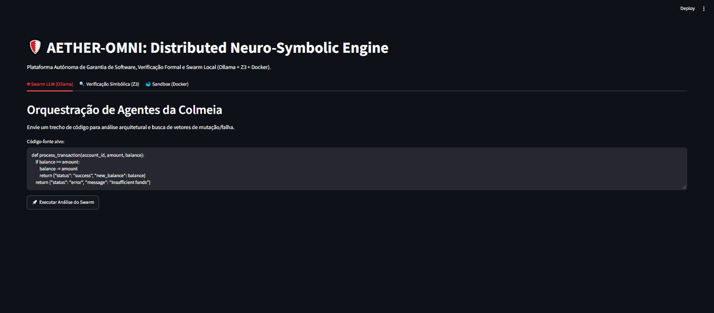

# 🛡️ AETHER-OMNI: Distributed Neuro-Symbolic Self-Evolving Software Architecture

[](https://www.python.org/)
[](https://streamlit.io/)
[](https://www.docker.com/)
[](https://github.com/Z3Prover/z3)
[](LICENSE)



**AETHER-OMNI** is an advanced software assurance and automated resilience framework that combines **Local LLM Swarms (Ollama)**, **Formal Symbolic Verification (Z3 Solver)**, and **Containerized Sandboxing (Docker)** to perform automated code audits, invariant proofs, and self-healing mutations.

---

## 🏛️ Architecture Overview

The system is engineered around three core pillars:
1. **The Swarm (`core/swarm.py`)**: Local multi-agent orchestration via Ollama, dividing responsibilities between senior architecture analysis (`AETHER-ARCHITECT`) and edge-case/mutation detection (`AETHER-DESTRUCTOR`).
2. **Symbolic Verification (`core/symbolic.py`)**: Mathematical validation of code logic using Microsoft's Z3 Solver to prove or disprove system invariants and prevent logical flaws.
3. **Secure Sandbox (`core/sandbox.py`)**: Ephemeral, memory-limited, and network-isolated Docker containers to safely execute and test mutations.
4. **Telemetry Dashboard (`dashboard/app.py`)**: A centralized Streamlit control panel to monitor agent execution, mathematical proofs, and sandbox results in real time.

---

## 📂 Project Structure

```text
aether-omni/
├── config/                 # Configuration parameters and endpoints
├── core/
│   ├── __init__.py
│   ├── swarm.py            # Ollama Multi-Agent Orchestrator
│   ├── symbolic.py         # Z3 Solver Formal Verification Engine
│   └── sandbox.py          # Docker Container Security Manager
├── dashboard/
│   ├── app.py              # Streamlit Telemetry & Control UI
│   └── dashboard.png       # Interface screenshot source
├── docs/
│   └── dashboard.png       # Visual documentation asset
├── .gitignore              # Repository file exclusion rules
├── LICENSE                 # MIT Open Source License
├── requirements.txt        # Project dependencies
└── README.md               # Executive Documentation
